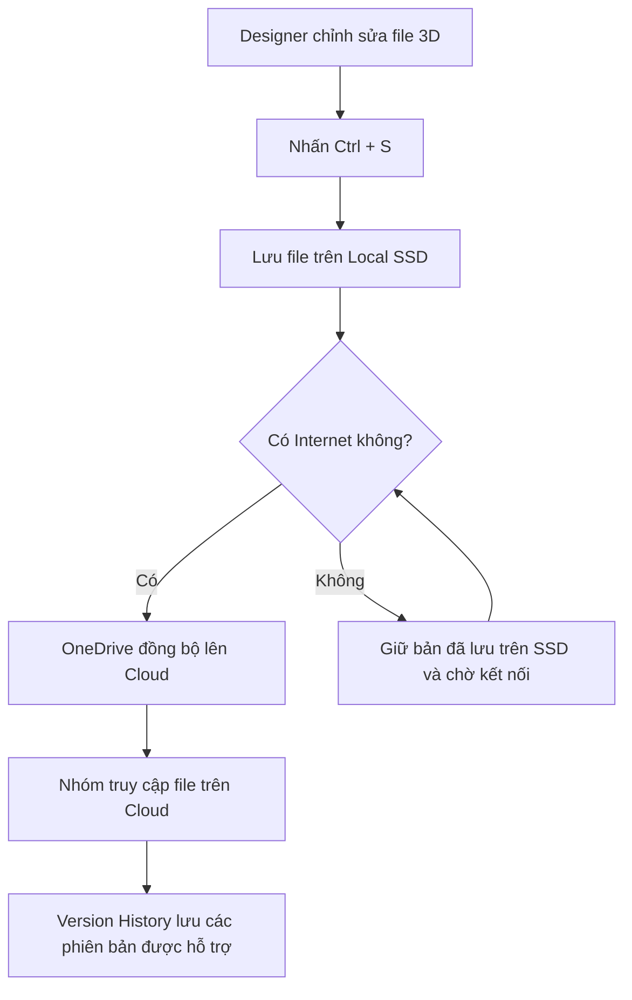

# BÁO CÁO: HYBRID WORKFLOW VÀ VERSION HISTORY

**Dự án:** Số hóa Bảo tàng PTIT  
**Chủ đề:** Bảo vệ và khôi phục file thiết kế 3D

## 1. Mục tiêu

- Kết hợp lưu file trên máy tính và trên Cloud để hạn chế mất dữ liệu.
- Tự động đồng bộ file sau khi chỉnh sửa và lưu.
- Dùng Version History để lấy lại bản thiết kế cũ khi bản mới bị lỗi.

## 2. Phân tích tình huống

Trong dự án Số hóa Bảo tàng PTIT, bạn A thiết kế mô hình 3D nhưng chỉ lưu file trên ổ cứng và đôi khi gửi qua Zalo. Khi ổ cứng bị lỗi Bad Sector, file bị hỏng, còn file trên Zalo đã hết hạn tải xuống.

**Nguyên nhân:** Nhóm chưa có cách sao lưu tự động, phụ thuộc vào một ổ cứng và chưa quản lý các phiên bản file.

**Giải pháp:** Sử dụng **OneDrive** để đồng bộ thư mục dự án giữa **Local SSD** và **Cloud**, kết hợp **Version History** và một bản sao lưu riêng.

## 3. Sơ đồ luồng dữ liệu

**Giải thích:** Khi nhấn `Ctrl + S`, file được lưu trên máy trước. OneDrive sẽ tự đồng bộ file lên Cloud khi có mạng. Vì vậy, **không thể khẳng định file đã lên Cloud ngay lập tức khi nhấn Ctrl + S**. Cần kiểm tra trạng thái đồng bộ để biết file đã tải lên thành công hay chưa.

## 4. Xử lý mất mạng hoặc sập nguồn

- **Mất Internet:** Nếu file đã được lưu trên SSD, Designer vẫn có thể tiếp tục làm việc với file có sẵn trên máy. Khi có mạng trở lại, OneDrive sẽ tiếp tục đồng bộ.
- **Sập nguồn:** Sau khi bật máy, kiểm tra file có mở được không và OneDrive có tiếp tục đồng bộ không. Nếu file đang ghi dở bị hỏng, có thể dùng bản tự phục hồi của phần mềm thiết kế hoặc bản cũ đã lưu trên Cloud.
- **Ổ cứng bị hỏng:** Đăng nhập OneDrive trên máy khác để tải lại **những file đã đồng bộ thành công**.

**Lưu ý:** Nếu máy hỏng trước khi bản mới kịp đồng bộ thì Cloud có thể chưa có bản đó. Nhóm nên bật tính năng tự phục hồi trong phần mềm thiết kế, kiểm tra trạng thái OneDrive và sao lưu thêm vào ổ cứng ngoài định kỳ.

## 5. Xử lý xung đột phiên bản (File Version Conflict)

**Ví dụ:** Bạn A và bạn B cùng chỉnh sửa một file 3D. A sửa khi mất mạng, còn B sửa và đồng bộ bản khác lên Cloud. Khi A kết nối lại, hai bản có thể bị xung đột.

**Cách xử lý:**

1. Không xóa hoặc ghi đè ngay một trong hai bản.
2. Lưu riêng hai bản, ví dụ `HienVat_A.blend` và `HienVat_B.blend`.
3. Nhóm so sánh nội dung, chọn bản đúng hoặc kết hợp các thay đổi, sau đó lưu thành bản chính và đồng bộ lại.

Để tránh xung đột, nhóm nên phân công một người chỉnh sửa file 3D tại một thời điểm và thông báo khi bàn giao file.

## 6. Khôi phục file bằng Version History

Khi một file đã đồng bộ lên OneDrive bị sửa nhầm hoặc lỗi, nhóm có thể:

1. Mở OneDrive trên trình duyệt và tìm file cần khôi phục.
2. Nhấp chuột phải vào file, chọn **Version History (Lịch sử phiên bản)**.
3. Chọn phiên bản cũ còn hoạt động tốt, xem lại nếu có thể và nhấn **Restore (Khôi phục)**.

**Lưu ý:** Version History chỉ khôi phục được những phiên bản đã được lưu và còn trong lịch sử của dịch vụ. Với file 3D, nên tải một bản cũ về kiểm tra trước khi thay thế bản hiện tại.

## 7. Quy trình thiết lập OneDrive cho Designer (3 bước)

### Bước 1: Cài đặt và đăng nhập

- Cài OneDrive hoặc mở ứng dụng OneDrive có sẵn trên Windows.
- Đăng nhập tài khoản được nhóm sử dụng.
- Tạo thư mục `BaoTangPTIT` trong thư mục OneDrive, sau đó đưa file dự án vào đây.

### Bước 2: Bật và kiểm tra đồng bộ

- Đảm bảo OneDrive đang chạy và không bị tạm dừng đồng bộ.
- Làm việc với file trong thư mục OneDrive; nhấn `Ctrl + S` sau khi chỉnh sửa.
- Bật tính năng tự lưu bản phục hồi trong phần mềm thiết kế nếu có.
- Khi mất mạng, tiếp tục lưu trên máy và chờ OneDrive đồng bộ lại sau khi có mạng.

### Bước 3: Chia sẻ và thử khôi phục

- Chia sẻ thư mục dự án cho thành viên, cấp quyền chỉnh sửa hoặc chỉ xem tùy nhiệm vụ.
- Kiểm tra file đã xuất hiện trên OneDrive web và không còn báo đang đồng bộ.
- Thử sửa một file mẫu nhiều lần, mở Version History và khôi phục một bản cũ để chắc chắn nhóm biết cách thực hiện.

## 8. Kết luận

Theo em, nhóm nên dùng **Hybrid Workflow** vì vừa có thể làm việc nhanh trên SSD, vừa có bản lưu trên Cloud để giảm nguy cơ mất dữ liệu. **Version History** giúp lấy lại bản vẽ cũ nếu sửa nhầm. Ngoài ra, nhóm cần kiểm tra đồng bộ thường xuyên, tránh nhiều người sửa cùng một file và có thêm bản sao lưu riêng để an toàn hơn.
